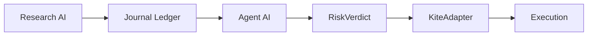

# ATLAS

**Autonomous Trading Logic & Analysis System** — an AI-driven research and decision system for the Indian market (equities and F&O).

> **Research-only.** ATLAS never places live orders. All execution paths run in paper-trading mode behind a mandatory risk gate.

---

## Overview

ATLAS separates *thinking* from *acting* with a strict Two-AI boundary. A Research AI produces a single structured output — a `DecisionProposal` — which is written to an append-only journal ledger. A separate Agent AI reads that ledger, applies a 5-check `RiskVerdict`, and only then may an order be routed through the broker adapter.

The model never sees raw market data. It only ever sees a frozen `StateSnapshot` whose values are computed in Python.

**Current state:** Research agent deployed on free LLM services (Oracle/AMD cloud), journal ledger for learning from past results, scheduled jobs subject to provider rate limits.

---

## Architecture

### Two-AI boundary



- Research AI never places orders directly.
- Every hand-off flows through the journal ledger (append-only JSONL).
- All 5 `RiskVerdict` checks must pass for approval.
- `StateSnapshot` is the only input the model ever sees.

### 6-layer stack

| Layer | Component | Description |
|-------|-----------|-------------|
| L1 | Data Ingestion | Market data, news feeds, sentiment sources |
| L2 | RAG Corpus | 12 Indian market regimes + 12 patterns (`atlas/rag_corpus.py`) |
| L3 | Research AI | `ConfigDrivenResearchAI.analyze()` — regime flags, alerts, thesis |
| L4 | DecisionProposal + RiskVerdict | Decision proposal plus 5-check risk verification |
| L5 | KiteAdapter | Zerodha Kite Connect order execution |
| L6 | Journal Ledger | Append-only JSONL with a complete cycle audit trail |

---

## Repository layout

```
atlas/
  orchestrator.py        # Wires all 6 layers; run_cycle()
  journal.py             # Two-AI journal-ledger protocol
  research_ai.py         # ConfigDrivenResearchAI.analyze()
  rag_corpus.py          # 12 Indian market regimes + 12 patterns
  decision_proposal.py   # DecisionProposal dataclass (Research AI's only output)
  risk_verdict.py        # 5-check risk verification
  state_snapshot.py      # Frozen dataclass — the model's only input
  eval_pipeline.py       # Evaluation pipeline + confidence calibration
  eval_set.py            # Outcome grading, mechanical call grading
  functions.py           # Shared helpers (rate limits, sizing, ledger export)
  brokers/
    kite_adapter.py      # Kite Connect adapter
scripts/
  daily_market_scan.py   # Scheduled market scan automation
market-scan/             # Generated daily scans and director reviews
.github/
  agents/                # Custom agent definitions
  skills/                # Skill configuration
  workflows/             # GitHub Actions automation
functions.py             # Top-level helper functions
validate_agents.py       # Agent frontmatter validation
ATLAS_NEXT_STEPS.md      # Prioritized roadmap
copilot-instructions.md  # Contributor/agent guidance
```

---

## Agents

Custom agents live in `.github/agents/`:

| Agent | Role |
|-------|------|
| **Goldmen Intern** | Indian equity market scan and intelligence reporting; feeds the ATLAS RAG corpus |
| **The Director** | Reviews intern reports, produces executive summaries and mentorship feedback |
| **Sensei** | ATLAS architecture assistant — agent creation, 6-layer management, regime detection |
| **Pacman** | Platform engineer — repository integration and end-to-end feature engineering (L1–L6) |
| **Jira Agent** | Jira issue management via the Atlassian MCP server |
| **Notion Agent** | Notion page/database management via the Notion MCP server |
| **Custom Agent Template** | Starting point for new agents |

Validate agent frontmatter with `validate_agents.py`. It checks that each agent file has `name`, `description`, and `tools` in its YAML frontmatter:

```bash
python validate_agents.py
```

> The script reads from `~/.copilot/agents` (set by `AGENTS_DIR` in `validate_agents.py`), not from `.github/agents/`.

---

## Automation

`.github/workflows/daily-market-scan.yml` runs `scripts/daily_market_scan.py` at **9:00 AM IST (03:30 UTC), Monday–Friday**, and commits the generated report to `market-scan/`. It can also be triggered manually via `workflow_dispatch`.

---

## Quick start

```bash
# Clone
git clone https://github.com/SuryaVamsi009/ATLAS.git
cd ATLAS

# Run the market scan locally
python scripts/daily_market_scan.py

# Validate agent definitions
python validate_agents.py
```

Requires Python 3.11+. The market scan depends on `requests`, `beautifulsoup4`, `lxml`, `python-dateutil`, and `pytz`.

### Programmatic usage

`Orchestrator.run_cycle()` runs one full pass through all six layers and returns every intermediate result:

```python
from atlas.orchestrator import Orchestrator, OrchestratorConfig

bars = [
    # [timestamp, open, high, low, close, volume]
    [1730428800000, 35000.0, 35200.0, 34900.0, 35100.0, 1500.0],
    [1730515200000, 35100.0, 35300.0, 35050.0, 35250.0, 1800.0],
    [1730601600000, 35250.0, 35400.0, 35200.0, 35350.0, 2000.0],
]

config = OrchestratorConfig(paper_trading=True, ai_provider="rule_based")
orchestrator = Orchestrator(config)

result = orchestrator.run_cycle(
    market_data=bars,
    news_context="Nifty flat ahead of RBI policy.",
    context_dict={"symbol": "NIFTY", "timeframe": "1d"},
)

print(result["step2_regime_flags"])
print(result["step3_decision_proposal"])
print(result["step4_risk_verdict"])
```

The returned dict contains `step1_snapshot`, `step2_regime_flags`, `step2_event_alerts`, `step3_decision_proposal`, `step4_risk_verdict`, `step5_order_placed`, `step5_order_details`, `step6_journal_entry`, `step7_success`, and `step7_error`.

---

## Journal-ledger protocol

Every complete cycle writes a structured ledger entry:

| Field | Description |
|-------|-------------|
| `entry_id` | Unique identifier |
| `timestamp_ist` | IST timestamp |
| `snapshot_id` | Reference to the frozen `StateSnapshot` |
| `regime_flags` | Detected market regimes |
| `event_alerts` | Generated event alerts |
| `thesis` | Research thesis / rationale |
| `decision_proposal` | Buy/sell/hold call with confidence score |
| `risk_verdict` | Pass/fail from 5 checks |
| `order_result` | Filled / partial / cancelled / rejected |
| `pnl` | Profit/loss from the executed trade |
| `confidence_calibration` | Calibration data for learning |

All cycles are journaled — including risk-rejected ones — so the audit trail is complete.

---

## Configuration

- **Default `rag_weight`:** `0.3` (rule-based dominant, RAG supplementary)
- **LLM provider start:** OpenAI `gpt-4o-mini` (cost-effective)
- **RiskVerdict checks:** 5 must all pass — `size_ok`, `loss_ok`, `hours_ok`, `symbol_ok`, `confidence_ok`
- **Monitoring output:** both a JSON file and a CLI summary

---

## Roadmap

See [`ATLAS_NEXT_STEPS.md`](ATLAS_NEXT_STEPS.md) for full detail. Prioritized order:

1. Journal integration with `Orchestrator.run_cycle()`
2. Rate-limit handling and retry logic
3. LLM provider integration
4. Paper-trading end-to-end verification
5. Confidence calibration pipeline
6. Indian market patterns in the Research AI
7. Monitoring and alerting for scheduled orchestration

---

## Development guidelines

- **Model-agnostic design** — switching AI provider is a config change, not a logic change.
- **Rule-based fallback** — keep rule-based regime detection as the default for robustness.
- **Journal every cycle** — including risk-rejected cycles, for a complete audit trail.
- **Per-cycle rate-limit protection** — reset each run, with an optional daily reset via cron.
- **Concrete question before starting** — each roadmap step has a specific question to answer first.

---

## Contributing

1. Read `atlas/orchestrator.py` to understand the cycle flow.
2. Read `atlas/journal.py` to understand the ledger protocol.
3. Read `atlas/research_ai.py` to understand the research agent design.
4. Review `ATLAS_NEXT_STEPS.md` for the prioritized roadmap.
5. Start with Step 1: Journal Integration — the foundation for everything else.
